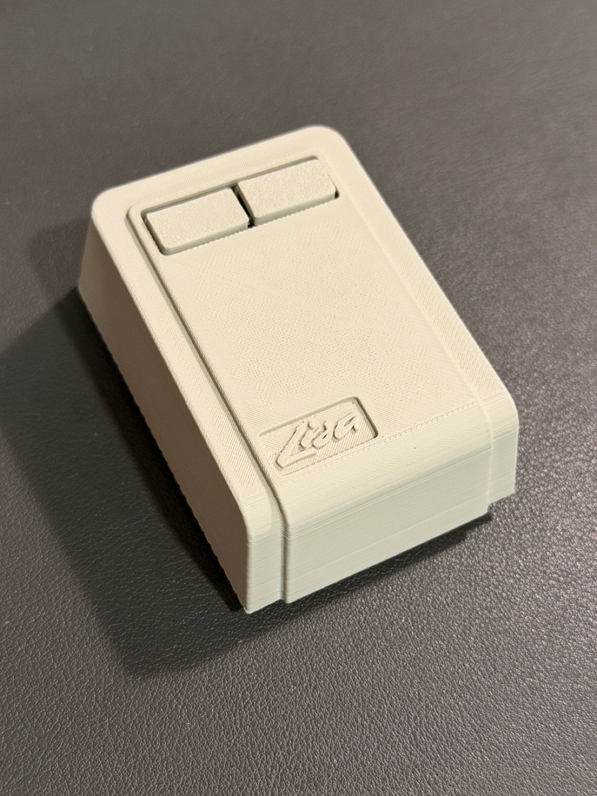
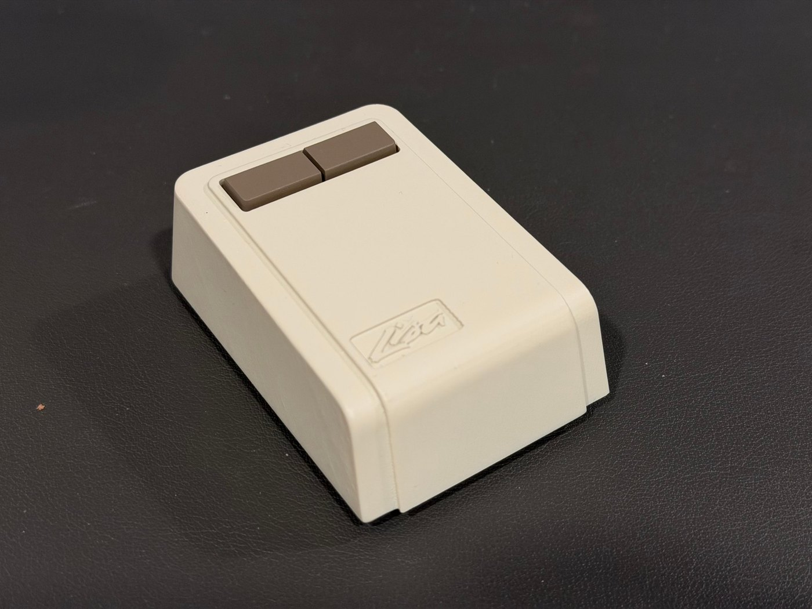
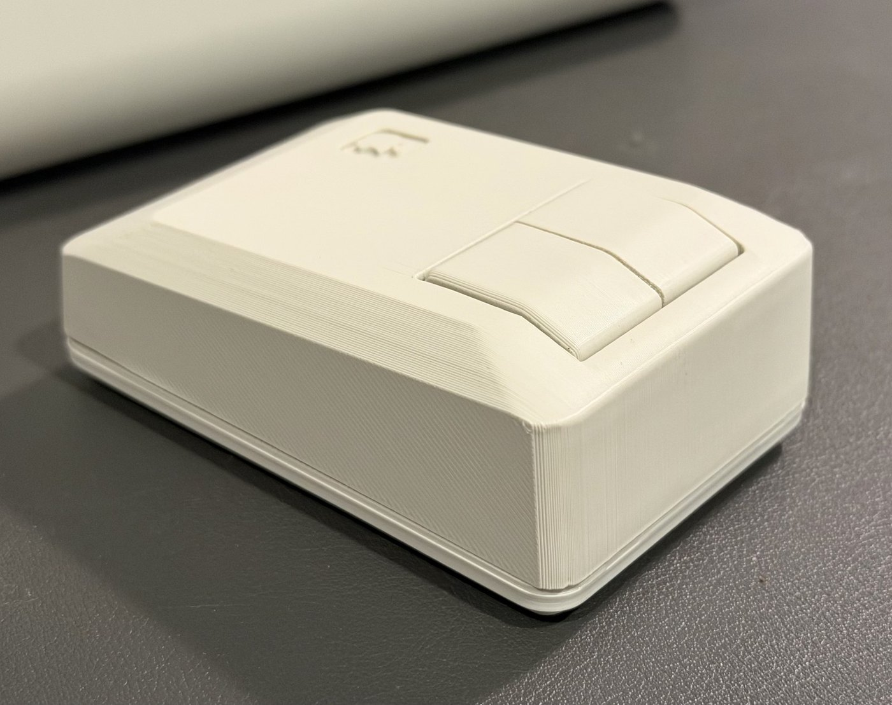
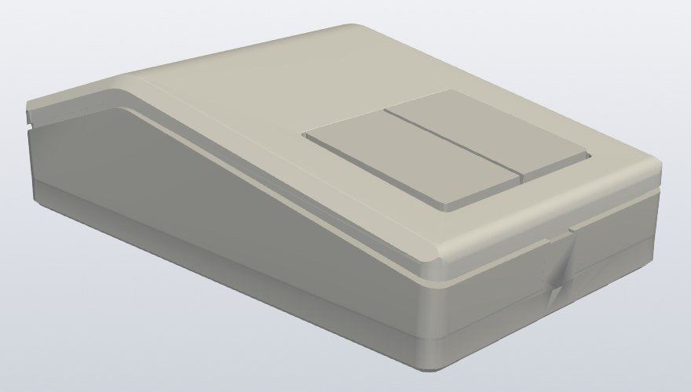
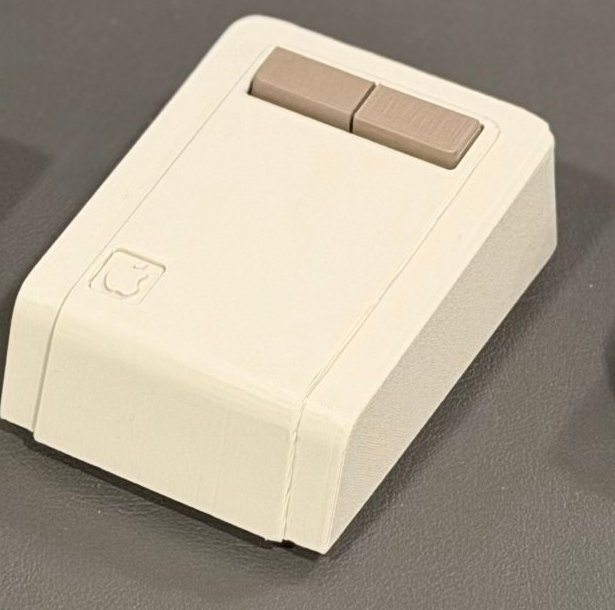

# Vintage Apple Mice — Logitech M185 conversions

3D-printed replicas of three classic Apple mice, each built around the electronics of a
**Logitech M185** wireless mouse: its board, optical sensor, switches and AA battery go inside a
printed shell. They work like any modern wireless mouse (USB receiver, no drivers) and have
**two buttons**, where the originals had one.

Each mouse is its own project, with print-ready STLs, printing and assembly guides, and the
scripts that build the models. This page shows them side by side and links to each.

| Mouse | Project |
|-------|---------|
| **Apple Lisa mouse** (1983) | [wottle/lisa-mouse-logitech-m185](https://github.com/wottle/lisa-mouse-logitech-m185) |
| **Apple Macintosh mouse, M0100** (1984) | [wottle/mac-mouse-logitech-m185](https://github.com/wottle/mac-mouse-logitech-m185) |
| **Apple Desktop Bus mouse, G5431** (1986, Apple IIGS; Macintosh SE and II) | [wottle/adb-mouse-logitech-m185](https://github.com/wottle/adb-mouse-logitech-m185) |

## Variants

Every mouse comes in two versions that differ only in the shell:

- **FDM** (filament printers): the shell's sides are flat and parallel, so it can print standing on
  its side, which gives the top a clean finish.
- **Resin**: the shell keeps the original mouse's sloping sides (and, on the ADB mouse, its rounded
  top edges), which resin prints cleanly.

The buttons, battery door and other inner parts are shared by both versions of each mouse.

<table>
<tr><th></th><th>FDM</th><th>Resin</th></tr>
<tr>
<td><b>Lisa</b></td>
<td> With the Lisa wordmark plate.</td>
<td> With the Lisa wordmark plate.</td>
</tr>
<tr>
<td><b>Macintosh M0100</b></td>
<td></td>
<td><i>Photo to come.</i></td>
</tr>
<tr>
<td><b>ADB G5431</b></td>
<td> Render; photo to come.</td>
<td><i>Photo to come.</i></td>
</tr>
</table>

The Lisa and Macintosh photos are PLA prints made before the FDM shells got their flat sides, so they show
the original sloping sides, as on the resin shells.

The Lisa mouse with the Apple logo plate instead of the Lisa wordmark:

## How they compare

| | Lisa | Macintosh M0100 | ADB G5431 |
|---|---|---|---|
| **Case** | Top shell over a flat base plate | Upper and lower shells | Upper and lower shells, low and boxy |
| **Shells printed per variant** | Top shell (from `fdm/` or `resin/`) | Upper shell | Upper and lower shells |
| **Buttons** | Hinged on pins, held by a retainer plate; a screw under each sets its click point | Like the Lisa mouse's: hinged in the upper shell, held by a retainer plate, a screw under each sets its click point | One-piece flexures (each bends at a thin hinge, as on the original) clamped under the hump; a stop screw sets the click point. A short-throw pair (default) and a longer-throw pair |
| **Logo** | Separate plate glued into a recess: the Lisa wordmark, or a blank square plate for an Apple logo | Separate plate (blank square, for an Apple logo) | Moulded into the shell, as on the original |
| **Battery door** | Lisa design | The Lisa mouse's | Its own, lower-profile pair (the Lisa door does not fit) |
| **Status** | Printed and assembled | Printed and test-fitted; still being refined | FDM version printed and assembled |

The three share the M185 mounting inside (the board seats, screws and sensor window), the AA
battery bay and the power slider. These come from the Lisa project, which took the mounting from the
Amiga mouse credited below.

## What you need

For any of them:

- A **genuine Logitech M185**. Knock-offs sold as the M185 on discount marketplaces have a different
  board and will not fit. Buy from Logitech or an authorized seller.
- A 3D printer: FDM with a 0.4 mm nozzle (PLA), or resin for the resin shells.
- One AA battery, a small Phillips screwdriver, and M3 screws (each project lists its own sizes and
  counts).
- Optional: self-adhesive PTFE mouse feet.

Then follow that mouse's `docs/PRINTING.md` and `docs/ASSEMBLY.md`. The Lisa mouse's assembly guide
has the step-by-step photos for taking the M185 apart, which is the same for all three.

## Credits

The shells are remixes of existing models. Thank you to their creators:

- **Apple Lisa mouse** by Stephen Arsenault (StephenLulz): <https://www.thingiverse.com/thing:6547918>
- **Apple Desktop Bus Mouse, Model G5431 (Shell)** by StephenLulz: <https://www.thingiverse.com/thing:4545460>
- **Apple Macintosh mouse M0100**: see the [Macintosh project's credits](https://github.com/wottle/mac-mouse-logitech-m185#credits).
- **Amiga Mouse (Logitech M185)** by TomekB_239528: <https://www.printables.com/model/1137373-amiga-mouse-logitech-m185>,
  the original M185 mounting.

## License

This page and its photos: [CC BY-NC-SA 4.0](LICENSE). Each project has its own license and credits; see
its README.
